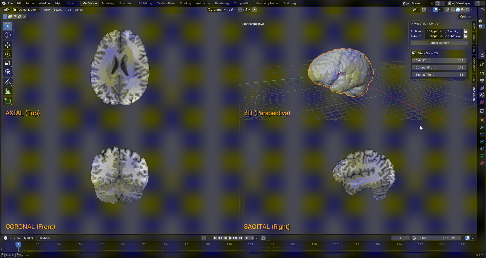

# Research_Blender_MedVisor

MedVision es un **orquestador de software médico** para el análisis de Resonancias Magnéticas (MRI) que coordina varias herramientas neurocientíficas especializadas (HD-BET, FSL FAST, SIENAX, SIENA) bajo una interfaz única. Tiene dos modos de uso:

- **Modo Headed** (add-on de Blender): aísla el cerebro con IA, clasifica sus tejidos y genera un entorno clínico interactivo — una malla 3D sincronizada con visores ortogonales 2D — para inspeccionar y discutir clínicamente un caso concreto.
- **Modo Headless** (script de línea de comandos): procesa resonancias en lote sin abrir Blender, pensado para análisis masivo, integración en otros sistemas, o generación automática de informes.

Ambos modos comparten el mismo pipeline de base (HD-BET + FSL), pero el Headless añade medidas estadísticas (volumen normalizado con SIENAX, atrofia longitudinal con SIENA) orientadas a la detección de anomalías.

---

## Índice

1. [Prerrequisitos](#prerrequisitos)
2. [Preparación de datos: convertidor DICOM → NIfTI](#preparación-de-datos-convertidor-dicom--nifti)
3. [Modo Headed: add-on de Blender](#modo-headed-add-on-de-blender)
4. [Modo Headless: CLI](#modo-headless-cli)
5. [Informes generados](#informes-generados)
6. [Arquitectura y funcionamiento interno](#arquitectura-y-funcionamiento-interno)
7. [Estado de validación](#estado-de-validación)
8. [Limitaciones y buenas prácticas](#limitaciones-y-buenas-prácticas)
9. [Estructura del proyecto](#estructura-del-proyecto)
10. [Reconocimientos y referencias](#reconocimientos-y-referencias)

---

## Prerrequisitos

Este proyecto usa una arquitectura híbrida: Blender y los scripts corren en Windows, pero las herramientas neurocientíficas más robustas (FSL) son nativas de UNIX. MedVision actúa como puente mediante WSL.

1. **HD-BET (Windows):** red neuronal para la extracción craneal (skull-stripping).
2. **WSL (Windows Subsystem for Linux):** ejecuta los comandos de FSL de forma transparente desde Blender y desde el CLI.
3. **FSL (dentro de WSL):** `FAST` (segmentación de tejidos), `SIENAX` (volumen normalizado) y `SIENA` (atrofia longitudinal). Instálalo con el instalador oficial:
   ```bash
   wget https://fsl.fmrib.ox.ac.uk/fsldownloads/fslinstaller.py
   python3 fslinstaller.py
   ```
   Comprueba que `$FSLDIR/bin` quede en el `PATH` de tu distro WSL. Si algún comando de FSL no se encuentra desde Windows, revisa `~/.bashrc` / `~/.profile`.
4. **dcm2niix (Windows):** solo si vas a usar el convertidor (ver más abajo).

Incluye además un **convertidor masivo DICOM → NIfTI** (`convertidor_masivo.py`) pensado para la estructura de carpetas que descarga ADNI.

> **Aviso:** MedVision es una herramienta de investigación y de demostración técnica. No está validada ni certificada para uso clínico y sus resultados no deben usarse para tomar decisiones médicas. Consulta la sección [Estado de validación](#estado-de-validación) para saber exactamente qué se ha comprobado y qué no.

### Dependencias de Python

| Componente | Paquetes |
|---|---|
| HD-BET | PyTorch y `hd-bet` (ver abajo) |
| Modo Headless (`main.py`) | `nibabel`, `numpy` |
| Convertidor (`convertidor_masivo.py`) | `dcm2niix` (ejecutable externo); `nibabel` opcional (comprobación de cabecera); `dicom2nifti` solo con `--motor dicom2nifti` |
| Add-on de Blender | `SimpleITK`, `scikit-image`, `numpy`, que deben estar instalados **en el Python que incluye Blender**, no en el del sistema |

**HD-BET:** requiere PyTorch y las librerías de IA suelen ir por detrás de las últimas versiones de Python, así que instálalo con una versión de Python compatible y estable (conviene un entorno virtual).

1. `pip install hd-bet` (con PyTorch ya configurado) o sigue el [repositorio oficial](https://github.com/MIC-DKFZ/hd-bet).
2. Anota la ruta completa del ejecutable (ej. `C:\Ruta\A\Tu\Python\Scripts\hd-bet.exe`).

> Con una GPU compatible con CUDA el proceso es mucho más rápido; en CPU puede tardar varios minutos por imagen.

**Dependencias del add-on en Blender:** instálalas con el Python de Blender (ajusta la ruta a tu versión):

```bash
"C:\Program Files\Blender Foundation\Blender 3.6\3.6\python\bin\python.exe" -m pip install SimpleITK scikit-image
```

**Configuración (`config.ini`)** en la raíz del proyecto, con las rutas que no cambian entre pacientes:

```ini
[Rutas]
hdbet = C:\Ruta\A\Tu\Python\Scripts\hd-bet.exe
```

---

## Preparación de datos: convertidor DICOM → NIfTI

`convertidor_masivo.py` convierte series T1 descargadas de ADNI (u otras con estructura parecida) a NIfTI con nombres que el pipeline entiende.

Estructura de entrada esperada:

```
ADNI/<sujeto>/<descripcion_serie>/<AAAA-MM-DD_hh_mm_ss.0>/<ImageID>/*.dcm
```

### Instalar dcm2niix

Opción A, con pip:

```bash
python -m pip install dcm2niix
```

Opción B, descarga manual del `dcm2niix_win.zip` desde [github.com/rordenlab/dcm2niix](https://github.com/rordenlab/dcm2niix) (sección *Releases*).

Si Windows no encuentra el ejecutable (frecuente tras `pip install --user`, que lo deja en `...\Python\PythonXY\Scripts`), no hace falta tocar el PATH: pasa la ruta con `--dcm2niix`.

### Uso

```bash
python convertidor_masivo.py -i C:\datos\ADNI -o C:\datos\salida
python convertidor_masivo.py --dcm2niix "C:\ruta\dcm2niix.exe"
```

| Opción | Descripción |
|---|---|
| `-i`, `--origen` | Carpeta con una subcarpeta por sujeto (por defecto, la definida en el script: edítala o pásala) |
| `-o`, `--destino` | Carpeta de salida de los `.nii.gz` |
| `--motor` | `dcm2niix` (por defecto) o `dicom2nifti` (alternativa; no corrige inclinación de gantry ni genera `.json`) |
| `--dcm2niix` | Ruta al ejecutable si no está en el PATH |
| `--patron` | Expresión regular para reconocer series T1 en la ruta (por defecto `mp.?rage\|spgr\|t1`) |
| `--min-archivos` | Mínimo de DICOM para considerar que una carpeta es un volumen (por defecto 20) |
| `--forzar` | Reconvierte aunque el `.nii.gz` ya exista |

### Qué produce

- Un NIfTI por serie T1, con nombre compatible con BIDS: `sub-<ID>_ses-<AAAAMMDD>[_run-NN]_T1w.nii.gz`. El ID se escribe sin guiones bajos (`002_S_0619` → `002S0619`); la fecha sale de la ruta y se usa como etiqueta de sesión, de modo que ordena correctamente como texto. Si hay varias series el mismo día se añade `_run-01`, `_run-02`…
- Un `.json` junto a cada NIfTI (el de dcm2niix, completado con `SeriesDescription` y `AcquisitionDate`).
- `conversion_manifest.csv`, con forma, tamaño de vóxel, orientación y desviación de ortogonalidad de cada volumen. Si la desviación supera 0,01 el script avisa de posible inclinación o cizallamiento.
- Un resumen final con los sujetos que tienen dos o más sesiones (candidatos a SIENA).

No sobrescribe lo ya convertido salvo con `--forzar`.

---

## Modo Headed: add-on de Blender

*Desarrollado y validado para Blender **3.6** o superior.*

### Instalación

1. Descarga el código del repositorio como `.zip`.
2. En Blender: **Edit > Preferences > Add-ons > Install...** y selecciona el `.zip`.
3. Activa la casilla `3D View: MedVision`.
4. Instala `SimpleITK` y `scikit-image` en el Python de Blender (ver [Prerrequisitos](#dependencias-de-python)).

### Uso

1. El add-on crea un *Workspace* llamado **MedVision** con vista cuádruple (*QuadView*).
2. En el panel lateral del *Viewport* (tecla `N`) abre la pestaña **MedVision Control**.
3. **Archivo MRI:** elige tu volumen `.nii.gz`.
4. **Ruta HD-BET:** ruta completa al ejecutable de `hd-bet`.
5. **Extraer Cerebro:** ejecuta HD-BET y FAST en segundo plano (Blender no se congela), genera la malla 3D centrada y orientada y carga los visores 2D.
6. **Capa FSL:** alterna la visualización entre materia gris, materia blanca y LCR, superpuestas o aisladas.
7. **Navegación 2D:** rueda para zoom, clic central para desplazar, clic izquierdo para sincronizar los tres cortes (cruz roja). El botón de refresco recentra las vistas.



---

## Modo Headless: CLI

Se ejecuta con `main.py`. Tiene dos subcomandos, porque **SIENAX** (transversal: un paciente, un momento) y **SIENA** (longitudinal: mismo paciente, dos fechas) necesitan entradas distintas.

```bash
python main.py -o <carpeta_salida> -c config.ini <t|l> ...
```

### Nomenclatura de archivos

El pipeline espera nombres tipo BIDS: `sub-<ID>_ses-<sesión>_T1w.nii.gz`. El convertidor ya los genera así. Reglas que se aplican:

- **Solo se procesan T1.** Se decide con el `.json` asociado si existe (`SeriesDescription` / `ProtocolName`) y, si no, con el nombre del archivo; T2 y FLAIR se descartan.
- **Usa etiquetas de sesión que ordenen bien como texto** (por ejemplo `ses-20060601`), porque el orden entre sesiones se comprueba comparando cadenas.
- En el modo transversal, si el nombre no sigue BIDS, el sujeto se identifica con el nombre del archivo para que dos resonancias distintas no se sobrescriban en el JSON.

### Análisis transversal (FAST y, opcionalmente, SIENAX)

```bash
python main.py -o ./salida -c config.ini t -i ./carpeta_con_resonancias --sienax
```

- `-i` acepta un archivo `.nii.gz` o una carpeta con varios.
- Sin `--sienax` solo se calculan los volúmenes absolutos (HD-BET + FAST).
- Con `--sienax` se añade el volumen normalizado. SIENAX se ejecuta sobre la **imagen original con cráneo**, no sobre la salida de HD-BET (necesita el cráneo para estimar la escala respecto al espacio estándar).
- En `<salida>/<archivo>_sienax/` quedan, además de lo que genera SIENAX, la imagen extraída por HD-BET (`*_bet.nii.gz`) y `*_pveseg.nii.gz`.

### Análisis longitudinal (SIENA)

```bash
python main.py -o ./salida_m -c config.ini l \
    --a ./sub-0001_ses-20060601_T1w.nii.gz \
    --r ./sub-0001_ses-20080813_T1w.nii.gz \
    --siena_opts="-m"
```

- `--a` es la sesión más antigua; `--r`, la más reciente.
- `--siena_opts` pasa opciones a SIENA tal cual. Usa la forma con `=` y comillas, porque el valor empieza por guion. Si se omite, SIENA corre con sus opciones por defecto.
- El resultado principal es el **PBVC**, el porcentaje de cambio de volumen cerebral entre ambas fechas.

**Comprobaciones previas del CLI:** ambos archivos existen, ambos son T1, pertenecen al mismo sujeto (identificable) y, si `--a` parece posterior a `--r`, avisa de que el signo del PBVC se invertirá.

**Una carpeta de salida nueva por configuración.** SIENA escribe en `<salida>/<sujeto>_<sesA>_vs_<sesB>_siena`. Si esa carpeta ya existe, el CLI se niega a ejecutar: en una prueba, dos ejecuciones con distintas opciones compartieron carpeta y dieron un PBVC que no se reprodujo al repetirlas en carpetas limpias. Borra la carpeta o usa otro `-o` para cada configuración.

**Configuración recomendada:** `--siena_opts="-m"`, que descarta los puntos de borde fuera de la máscara cerebral en espacio estándar (ojos, músculo). En los casos probados, el BET por defecto desbordaba hacia las órbitas en una de las sesiones; con `-m` el resultado fue estable (ver [validación](#estado-de-validación)).

---

## Informes generados

Cada ejecución produce dos salidas, calculadas una sola vez:

### `informe_volumetrico_medvision.json` (base de datos acumulativa)

No se sobrescribe entre ejecuciones: cada paciente, sesión o comparación nueva se incorpora a su entrada.

```json
{
  "metadata": { "fecha_creacion_bd": "...", "herramientas": "..." },
  "pacientes": {
    "sub-0001": {
      "sesiones": {
        "ses-20060601": {
          "fecha_adquisicion": "...",
          "archivo_original": "...",
          "volumenes_absolutos_mm3": {
            "materia_gris": 0, "materia_blanca": 0, "liquido_cefalorraquideo": 0,
            "cerebro_total": 0, "volumen_tejido_mascara_hdbet": 0
          },
          "volumenes_sienax_normalizados": {
            "v_scale": 0,
            "materia_gris_normalizada": 0, "materia_gris_sin_normalizar": 0,
            "materia_blanca_normalizada": 0, "materia_blanca_sin_normalizar": 0,
            "volumen_cerebral_total_normalizado": 0, "volumen_cerebral_total_sin_normalizar": 0
          }
        }
      },
      "comparaciones_longitudinales": {
        "ses-20060601_vs_ses-20080813": {
          "archivo_basal": "...",
          "archivo_seguimiento": "...",
          "pbvc_porcentaje": 0
        }
      }
    }
  }
}
```

Cómo leer los volúmenes:

- `cerebro_total` es GM+WM absolutos (HD-BET + FAST). `volumen_tejido_mascara_hdbet` es GM+WM+LCR dentro de la máscara de HD-BET; **no es el volumen intracraneal**.
- Los volúmenes normalizados de SIENAX provienen de **otra segmentación** (BET y FAST internos de SIENAX) y se multiplican por `v_scale`. **No equivalen a "volumen absoluto × v_scale"** y no deben compararse directamente con los absolutos (ver validación).

### `informe_<modo>_<timestamp>.html` (autocontenido, un solo archivo)

- **Transversal:** tabla de volúmenes absolutos y normalizados, y las imágenes de control de calidad de SIENAX (extracción craneal, registro al MNI152, máscaras, segmentación). El BET que se ve ahí es el interno de SIENAX, no HD-BET.
- **Longitudinal:** PBVC, los dos valores `PBVC` intermedios que reporta SIENA (guardados sin interpretar), las opciones de SIENA aplicadas y las imágenes de QA (alineación, BET de cada sesión, máscaras de campo de visión, segmentación, renderizado del desplazamiento; en el render, rojo-amarillo indica aumento de volumen y azul disminución).
- Metodología y referencias.

Los informes HTML y el JSON se generan sin volver a ejecutar ningún subproceso.

---

## Arquitectura y funcionamiento interno

### Pipeline transversal (Headless)

1. **Filtrado T1** de la entrada (metadatos o nombre).
2. **HD-BET** aísla el parénquima cerebral.
3. **FSL FAST** (`-t 1 -n 3 -p`, vía WSL) calcula los mapas de volumen parcial: `pve_0` = LCR, `pve_1` = materia gris, `pve_2` = materia blanca. El volumen de cada tejido es la suma de su mapa por el volumen del vóxel.
4. **SIENAX** (opcional) sobre la imagen original: BET, registro afín al MNI152 para obtener el factor de escala (`VSCALING`), segmentación y volúmenes normalizados. El pipeline lee `report.sienax` y comprueba que normalizado = sin normalizar × `VSCALING`, avisando si no cuadra.

### Pipeline longitudinal (Headless)

SIENA (vía WSL) sobre las dos imágenes originales: BET de cada una, registro a un espacio intermedio y medida del desplazamiento de los bordes cerebrales entre ambas fechas. Se lee `report.siena` (`finalPBVC` y las dos líneas `PBVC`). Se mide el desplazamiento de los contornos en lugar de restar dos volúmenes calculados por separado, porque los errores sistemáticos de dos segmentaciones independientes no se cancelan al restar.

### Modo Headed (exclusivo)

- **Procesado en segundo plano:** HD-BET y FAST corren en un hilo secundario con comunicación por cola, para que la interfaz de Blender no se bloquee.
- **Reconstrucción 3D:** *Marching Cubes* sobre el volumen para extraer la superficie y crear la malla.
- **Renderizado 2D (GPU):** los cortes axial, coronal y sagital se extraen de la matriz NumPy y se dibujan como texturas con el módulo `gpu` de Blender (`draw_handler`), con un HUD de texto y un lienzo opaco que oculta la geometría 3D en las vistas ortogonales.

---

## Estado de validación

Lo que se ha comprobado hasta ahora, y con qué alcance.

### SIENAX (tres sujetos de prueba, T1)

- El parseo de `report.sienax` es correcto: en los tres casos, volumen normalizado = volumen sin normalizar × `VSCALING` (coincidencia a más de seis cifras).
- El registro al MNI152 se revisó en las imágenes de QA y está alineado.
- Los volúmenes absolutos (HD-BET + FAST) y los de SIENAX sin normalizar **difieren** entre sí: en GM+WM, +4,1 %, −0,04 % y +5,0 % en los tres sujetos (en GM sola, hasta +6,6 %). Son dos segmentaciones distintas; no se deben mezclar ni comparar entre sí.

### SIENA (un sujeto de ADNI, dos MP-RAGE)

Datos: dos sesiones separadas por 804 días (2,20 años), mismo escáner (GE SIGNA EXCITE, 1,5 T), mismo protocolo (ángulo de inclinación 8°, tiempo de inversión 1 s; TR y TE difieren ~3 %). Convertidas con dcm2niix, con cabecera sin avisos (ejes ortogonales).

| Prueba | PBVC |
|---|---|
| Control: misma imagen dos veces | 0,0 % |
| Orden invertido (2008 → 2006) | +1,189 % (frente a −1,192 % en el orden directo) |
| Por defecto, conversión con dicom2nifti / con dcm2niix | −1,192 % / −1,157 % |
| `-m`, conversión con dicom2nifti / con dcm2niix | −1,183 % / −1,182 % |
| `-f 0.3` | −1,854 % (máscara de BET desbordada, **descartado**) |
| `-B -B` | −2,774 % (máscara de BET recortada por el frente, **descartado**) |

Los resultados con máscaras razonables se mantienen entre −1,16 y −1,19 %, es decir, **≈ −0,53 a −0,54 % por año**. Las dos configuraciones que se alejan lo hacen porque su máscara de BET es defectuosa, no porque la medida sea inestable.

### Qué NO está demostrado

- Es **consistencia del método, no exactitud**: no hay referencia externa para este sujeto (otro método, valores publicados individuales).
- Es **un solo paciente**. No se ha probado en controles sanos ni en otros pares longitudinales.
- El BET por defecto desborda hacia órbitas y músculo en una de las dos sesiones; `-m` mitiga el efecto en este caso, pero no se ha cuantificado en general.
- Las imágenes eran del tipo *Original* de ADNI, sin las correcciones de distorsión e intensidad que ofrece el proyecto para otras versiones.

Si reutilizas datos de ADNI, consulta sus términos de uso antes de redistribuir datos o publicar resultados.

---

## Limitaciones y buenas prácticas

- **Modalidad:** validado únicamente para MRI estructural **T1**. Angio-TC, PET u otras modalidades no son compatibles. SIENA exige exactamente la misma modalidad y contraste en las dos imágenes.
- **Revisa siempre las imágenes de QA** (BET de cada sesión, alineación, máscaras). El PBVC es sensible a la calidad del BET: una máscara que desborda o que recorta tejido produce valores que parecen razonables pero no lo son.
- **Mismo escáner y protocolo** en ambas sesiones siempre que sea posible. Cambios de fabricante, intensidad de campo o secuencia añaden incertidumbre que el pipeline no cuantifica.
- **Una carpeta de salida por configuración de SIENA** (el CLI bloquea la reutilización).
- **Registro de opciones:** el JSON acumulativo **no guarda** las opciones de SIENA ni los dos valores `PBVC` intermedios (solo `pbvc_porcentaje`), y la clave de la comparación (`<sesA>_vs_<sesB>`) no incluye las opciones; dos configuraciones distintas del mismo par se sobrescribirían en el JSON. El HTML sí muestra las opciones aplicadas. Mientras tanto, conserva un JSON por configuración (una carpeta de salida por configuración lo resuelve).
- **Tasa anual:** el JSON y el HTML solo muestran el PBVC total del intervalo; para compararlo entre sujetos hay que dividirlo por los años entre escaneos.
- **Dependencia de WSL:** FAST, SIENAX y SIENA se ejecutan en WSL. Si FSL no carga, revisa `$FSLDIR` y el `PATH` en `~/.bashrc` / `~/.profile`.
- **Rutas:** las rutas de Windows se convierten a `/mnt/<unidad>/...`. Evita caracteres especiales en las rutas.

---

## Estructura del proyecto

```
main.py                 CLI headless (subcomandos t y l)
config_manager.py       lectura de config.ini
core_neuro.py           HD-BET, FAST, SIENAX, SIENA, parseo de resultados
data_reports.py         JSON acumulativo e informe HTML
utils.py                rutas WSL, filtro T1, parseo BIDS, limpieza, imágenes de QA
convertidor_masivo.py   conversión DICOM -> NIfTI (ADNI)
config.ini              rutas del sistema (HD-BET); lo creas tú, está en .gitignore
__init__.py             registro del add-on de Blender
procesar_dicom.py       extracción de cerebro y malla 3D (add-on)
paneles_ui.py           panel, operadores y navegación 2D (add-on)
visor_slicer.py         visores 2D en GPU (add-on)
```

---

## Reconocimientos y referencias

Este proyecto es posible gracias a herramientas de código abierto de la comunidad científica:

- **[HD-BET](https://github.com/MIC-DKFZ/HD-BET)** (DKFZ): extracción craneal con redes neuronales convolucionales.
- **[FSL](https://fsl.fmrib.ox.ac.uk/fsl/docs/)** (Universidad de Oxford): `BET`, `FAST`, `FLIRT`, `SIENAX` y `SIENA`.
- **[dcm2niix](https://github.com/rordenlab/dcm2niix)**: conversión DICOM → NIfTI.
- **[SimpleITK](https://simpleitk.org/)**: orientación y lectura de imágenes en el modo Headed.
- **[NiBabel](https://nipy.org/nibabel/)** y **[NumPy](https://numpy.org/)**: lectura de mapas PVE, cálculo de volúmenes y gestión matricial.
- **[scikit-image](https://scikit-image.org/)**: *Marching Cubes* en el modo Headed.

Referencias:

- Smith, S.M., De Stefano, N., Jenkinson, M., Matthews, P.M. (2001). Normalized accurate measurement of longitudinal brain change. *J Comput Assist Tomogr*, 25(3):466-475. (SIENA)
- Smith, S.M., Zhang, Y., Jenkinson, M., Chen, J., Matthews, P.M., Federico, A., De Stefano, N. (2002). Accurate, robust, and automated longitudinal and cross-sectional brain change analysis. *NeuroImage*, 17(1):479-489. (SIENA / SIENAX)
- Smith, S.M. (2002). Fast robust automated brain extraction. *Human Brain Mapping*, 17(3):143-155. (BET)
- Zhang, Y., Brady, M., Smith, S. (2001). Segmentation of brain MR images through a hidden Markov random field model and the expectation-maximization algorithm. *IEEE Trans. Med. Imaging*, 20(1):45-57. (FAST)
- Isensee, F., et al. (2019). Automated brain extraction of multisequence MRI using artificial neural networks. *Human Brain Mapping*, 40(17):4952-4964. (HD-BET)
- Li, X., Morgan, P.S., Ashburner, J., Smith, J., Rorden, C. (2016). The first step for neuroimaging data analysis: DICOM to NIfTI conversion. *J Neurosci Methods*, 264:47-56. (dcm2niix)

Pipeline MedVision desarrollado por **Miriam Rodríguez García**.